# 🗺️ Mapa de Fusión y Flujo de Componentes del Sistema
**Proyecto:** Asistente de Orientación en Salud Pública sobre Dengue y Arbovirosis (Caso 05 - Grupo 5)  
**Seminario de Titulación UNIANDES 2026**

Este documento explica de forma gráfica y pedagógica **cómo interactúan y se fusionan los archivos clave** que hacen funcionar al asistente de orientación en dengue, incorporando la arquitectura completa de **Semanas 1, 2 y 3 (RAG Normativo + GeoSalud Determinista)**.

---

## 1. Diagrama Visual de Fusión de Archivos (Mermaid.js)

```mermaid
flowchart TD
    %% -------------------------------------------------------------
    %% CAPA DE CONFIGURACIÓN Y SECRETOS
    %% -------------------------------------------------------------
    subgraph ConfigLayer ["🔒 Capa de Configuración y Parámetros Desacoplados"]
        ENV[".env<br/><b>Secretos Locales</b><br/>GEMINI_API_KEY, GROQ_API_KEY, Timeouts"]
        Config["app/config.py<br/><b>Validador de Entorno</b><br/>Carga tolerante, alias y catálogo"]
        Umbrales["config/umbrales.json<br/><b>Parámetros RAG y Salud</b><br/>top_k: 2, distancia_max: 1.28, umbrales clínicos"]
    end

    %% -------------------------------------------------------------
    %% CAPA DE PRESENTACIÓN (FRONTEND)
    %% -------------------------------------------------------------
    subgraph FrontLayer ["💻 Capa de Presentación (Frontend)"]
        Streamlit["frontend/app.py<br/><b>Interfaz de Usuario (Streamlit)</b><br/>Chat, historial, selector GeoSalud y fuentes"]
    end

    %% -------------------------------------------------------------
    %% CAPA DE CONOCIMIENTO OFICIAL Y RAG (SEMANA 3)
    %% -------------------------------------------------------------
    subgraph RAGLayer ["📚 Capa de Conocimiento Oficial y RAG (Semana 3)"]
        Ingest["scripts/ingest.py<br/><b>Ingesta Reproducible</b><br/>Chunking por secciones normativas (OPS/MSP)"]
        Chroma[("data/index/<br/><b>Base Vectorial Persistente</b><br/>ChromaDB - dengue_ops_msp")]
        Retriever["app/services/retriever.py<br/><b>Recuperador RAG (SRP)</b><br/>Similitud semántica, filtro de distancia y citas"]
    end

    %% -------------------------------------------------------------
    %% CAPA DETERMINISTA GEOSALUD (DATOS TABULARES)
    %% -------------------------------------------------------------
    subgraph GeoLayer ["🏥 Capa Determinista de GeoSalud Ecuador (Datos Tabulares)"]
        GeoJSON[("data/geosalud_ecuador.json<br/><b>Directorio MSP Ecuador</b><br/>14 hospitales y centros tipo C")]
        GeoTool["app/tools/geosalud.py<br/><b>Herramienta Determinista</b><br/>Búsqueda por cantón/provincia, emergencias 24h y UCI"]
    end

    %% -------------------------------------------------------------
    %% CAPA DE ORQUESTACIÓN Y REGLAS CLÍNICAS (BACKEND)
    %% -------------------------------------------------------------
    subgraph BackLayer ["⚙️ Capa de Orquestación y Reglas Clínicas (Backend)"]
        Main["app/main.py<br/><b>Orquestador API (FastAPI)</b><br/>POST /api/chat, /api/chat/stream, GET /api/geosalud/centros"]
        Schemas["app/schemas.py<br/><b>Contrato Estricto (Pydantic)</b><br/>RespuestaAsistente, Fuente, RespuestaChatAPI"]
        ReglaOro{"Regla de Oro en Python<br/><b>ADR-004</b><br/>¿Detecta signos de alarma de dengue?"}
    end

    %% -------------------------------------------------------------
    %% CAPA DE INTELIGENCIA Y PROMPTS
    %% -------------------------------------------------------------
    subgraph AILayer ["🧠 Capa de Inteligencia Artificial Generativa"]
        Prompt["app/prompts/system_v3.md<br/><b>Directivas Enjauladas</b><br/>Rol, salvaguardas y prohibición de AINEs"]
        LLM["app/services/llm.py<br/><b>Cliente LLM Resiliente</b><br/>Reintentos 429, streaming y fallback dual"]
    end

    %% -------------------------------------------------------------
    %% SERVICIOS EXTERNOS Y OBSERVABILIDAD
    %% -------------------------------------------------------------
    subgraph ExternalServices ["☁️ Proveedores Externos y Telemetría"]
        Gemini["Google Gemini API<br/><b>gemini-3.8-flash (Principal)</b>"]
        Groq["Groq Cloud API<br/><b>openai/gpt-oss-20b (Respaldo)</b>"]
        AuditLogs[("logs/llm.jsonl<br/><b>Auditoría Técnica</b><br/>Tokens y latencia (Cero PII)")]
    end

    %% =============================================================
    %% CONEXIONES Y FLUJO NUMERADO
    %% =============================================================
    ENV -->|"1. Inyecta claves"| Config
    Config -->|"2. Configura cliente"| LLM
    Umbrales -->|"3. Parámetros top_k y umbral"| Retriever

    %% Ingesta previa
    Ingest -.->|"Indexación inicial offline"| Chroma

    %% Flujo de Consulta
    Streamlit -->|"4. Envía consulta del ciudadano"| Main
    Main -->|"5. Valida límites contra ataques"| Schemas

    %% Búsqueda RAG
    Main -->|"6. Consulta fragmentos oficiales"| Retriever
    Retriever <-->|"7. Búsqueda vectorial semántica"| Chroma
    Retriever -->|"8. Contexto + fuentes oficiales"| Main

    %% Inferencia LLM
    Main -->|"9. Inyecta prompt + contexto RAG"| LLM
    Prompt -->|"10. Directivas oficiales enjauladas"| LLM
    LLM -->|"11a. Inferencia primaria (Gemini)"| Gemini
    Gemini -.->|"11b. Fallback ante 429/503: Groq"| Groq
    LLM -->|"12. Registro métricas sin PII"| AuditLogs
    LLM -->|"13. Retorna propuesta estructurada"| Main

    %% Regla de Oro en Python
    Main -->|"14. Intercepta y evalúa clínicamente"| ReglaOro
    ReglaOro -->|"Si hay signos de alarma y menciona ciudad"| ConsultaGeo["Consulta app/tools/geosalud.py"]
    ConsultaGeo <-->|"Filtro determinista"| GeoJSON
    ConsultaGeo -->|"15a. Personaliza hospital local exacto"| ForzarDerivacion["🚨 Fuerza derivación urgente<br/>a Emergencias / Hospital local / 911"]
    
    ReglaOro -->|"Si no hay alarma"| MantenerRespuesta["✅ Mantiene orientación sanitaria<br/>con fuentes oficiales adjuntas"]

    ForzarDerivacion -->|"16. Inyecta fuentes RAG y alerta=True"| Main
    MantenerRespuesta -->|"16. Inyecta fuentes RAG y alerta=False"| Main

    Main -->|"17. Retorna RespuestaChatAPI a la UI"| Streamlit
    Streamlit -->|"18. Renderiza respuesta, citas y tarjeta de alerta"| FrontLayer
```

---

## 2. Detalle Archivo por Archivo: ¿Qué hace, por qué y para qué?

A continuación se detalla el papel específico de los **12 archivos clave** del sistema completo:

---

### 1. `frontend/app.py` (Interfaz de Usuario Streamlit)
- **¿Qué hace?**  
  Construye la interfaz web interactiva para el ciudadano: chat conversacional, bloqueo visual mediante spinner animado, visualización de citas oficiales en acordeón y consulta de hospitales en la barra lateral.
- **¿Por qué existe?**  
  Desacopla totalmente la capa de presentación de la lógica del servidor, permitiendo una experiencia accesible en teléfonos móviles y computadoras.
- **¿Para qué sirve en el flujo?**  
  Punto de interacción ciudadana. Se comunica con el backend vía HTTP (`/api/chat` y `/api/geosalud/centros`) y muestra en tarjetas rojas las derivaciones urgentes.

---

### 2. `app/main.py` (Orquestador y API REST FastAPI)
- **¿Qué hace?**  
  Punto de entrada de la API REST (`POST /api/chat`, `POST /api/chat/stream`, `GET /api/geosalud/centros` y `GET /health`). Orquesta el RAG, invoca el LLM y ejecuta la **Regla de Oro en Python (ADR-004)**.
- **¿Por qué existe?**  
  Aplica el principio de diseño: *«El modelo propone, el código dispone»*. Ninguna decisión crítica de salud se delega a la probabilidad del LLM.
- **¿Para qué sirve en el flujo?**  
  Coordina todos los componentes: valida la consulta, solicita evidencia al retriever RAG, pide inferencia al LLM y, si detecta signos de alarma, sobreescribe deterministamente la respuesta forzando el traslado a emergencias.

---

### 3. `app/schemas.py` (Contratos Estrictos Pydantic)
- **¿Qué hace?**  
  Define los modelos con validación rigurosa (`extra="forbid"`):
  - `SolicitudChat`: Texto del usuario (2 a 2000 caracteres, OWASP LLM10).
  - `RespuestaAsistente`: Esquema exclusivo para el modelo LLM (`respuesta`, `se_abstiene`, `derivar_a`).
  - `Fuente`: Metadatos normativos oficiales (`documento`, `seccion`).
  - `RespuestaChatAPI`: Objeto final devuelto por la API al frontend (`fuentes`, `proveedor`, `alerta_signo_alarma`).
- **¿Por qué existe?**  
  **Directiva antialucinación del Kit 3:** El modelo NO llena el campo de fuentes. Si se le pide al LLM, inventa citas ficticias. Las fuentes las adjunta exclusivamente el código Python a partir de lo recuperado en ChromaDB.
- **¿Para qué sirve en el flujo?**  
  Filtro de seguridad y aduana de datos: bloquea payloads corruptos e impide que el LLM alucine atributos inventados.

---

### 4. `config/umbrales.json` (Parámetros Clínicos y de RAG Desacoplados)
- **¿Qué hace?**  
  Centraliza en formato JSON los hiperparámetros operativos: `top_k: 2`, `distancia_maxima: 1.28`, ruta de base vectorial y umbrales médicos (plaquetas, días de fase crítica, vómitos).
- **¿Por qué existe?**  
  Evita valores "quemados" (*hardcoded numbers*) en el código Python, facilitando calibrar el sistema en producción sin modificar código ni recompilar.
- **¿Para qué sirve en el flujo?**  
  Alimenta al `RecuperadorDengue` para calibrar con exactitud el descarte de consultas irrelevantes.

---

### 5. `scripts/ingest.py` (Ingesta Reproducible y Chunking Temático)
- **¿Qué hace?**  
  Procesa las guías normativas de la OPS y el MSP, aplica **chunking por sección temática canónica** (500–800 palabras con el patrón oficial `/(?=SECCIÓN\s+\d+)/`), extrae metadatos y genera los vectores de embedding con `all-MiniLM-L6-v2`.
- **¿Por qué existe?**  
  Las guías médicas no tienen artículos como las leyes; su unidad canónica es la sección temática. Mantener el título oficial en el fragmento permite citar con precisión técnica.
- **¿Para qué sirve en el flujo?**  
  Crea y actualiza la base vectorial persistente en [`data/index/`](file:///c:/Users/rminaya/OneDrive%20-%20UNIANDES/Octavo%20-%20Seminario/Proyecto/data/index).

---

### 6. `app/services/retriever.py` (Servicio RAG con Responsabilidad Única)
- **¿Qué hace?**  
  Conecta con ChromaDB en [`data/index/`](file:///c:/Users/rminaya/OneDrive%20-%20UNIANDES/Octavo%20-%20Seminario/Proyecto/data/index), ejecuta búsquedas semánticas vectoriales, descarta resultados que superan la distancia máxima de 1.28 y formatea el contexto normativo.
- **¿Por qué existe?**  
  Principio SOLID (SRP): la API no debe conocer detalles de embeddings ni de ChromaDB. Cuenta además con *fallback graceful* (modo degradado seguro) si la base no existe.
- **¿Para qué sirve en el flujo?**  
  Entrega al orquestador el texto oficial relevante y la lista de objetos `Fuente` con el documento y sección oficial verificable.

---

### 7. `data/geosalud_ecuador.json` (Directorio Estructurado de Salud)
- **¿Qué hace?**  
  Base de datos tabular estructurada con 14 establecimientos de la red pública MSP en las zonas endémicas del Ecuador (Guayaquil, Portoviejo, Manta, Machala, Esmeraldas, Amazonía, etc.).
- **¿Por qué existe?**  
  **Regla Crítica del Módulo 3:** Los datos tabulares con atributos exactos **NUNCA se vectorizan en un RAG**, porque las bases vectoriales sufren para filtrar por campos exactos como provincia, dirección o guardia 24h.
- **¿Para qué sirve en el flujo?**  
  Suministra los registros oficiales de infraestructura hospitalaria para consultas exactas.

---

### 8. `app/tools/geosalud.py` (Herramienta Determinista en Python)
- **¿Qué hace?**  
  Función determinista que filtra el directorio GeoSalud por cantón o provincia (insensible a tildes/mayúsculas), emergencia 24 horas, pediatría y UCI.
- **¿Por qué existe?**  
  Garantiza respuestas 100% certeras sin alucinaciones cuando se requiere ubicar un hospital para derivar un paciente crítico.
- **¿Para qué sirve en el flujo?**  
  Alimenta al endpoint `GET /api/geosalud/centros` y personaliza automáticamente la derivación de emergencias en `app/main.py` si el paciente menciona su ciudad.

---

### 9. `app/prompts/system_v3.md` (Directivas Enjauladas del Asistente)
- **¿Qué hace?**  
  Define el System Prompt de producción estructurado en las 6 partes canónicas: Rol, Tarea, Criterios, Restricciones (prohibición de AINEs y cero prescripción), Abstención y Ejemplo Few-Shot.
- **¿Por qué existe?**  
  Enjaula el comportamiento probabilístico del LLM para que actúe estrictamente como un educador sanitario y no como un médico prescriptor.
- **¿Para qué sirve en el flujo?**  
  Guía la inferencia del modelo LLM junto con la evidencia recuperada por el RAG.

---

### 10. `app/services/llm.py` (Cliente Multi-Proveedor Resiliente)
- **¿Qué hace?**  
  Gestiona las llamadas a Gemini y Groq: implementa reintentos con espera exponencial ante errores HTTP 429 y conmuta por falla (*fallback dual*) de Google a Groq en milisegundos.
- **¿Por qué existe?**  
  Principio de Inversión de Dependencias (SOLID): la aplicación no depende de un único proveedor en la nube.
- **¿Para qué sirve en el flujo?**  
  Garantiza alta disponibilidad (99.9%) y cero caídas de servicio ante saturaciones de cuota.

---

### 11. `logs/llm.jsonl` (Bitácora de Observabilidad Técnica)
- **¿Qué hace?**  
  Registra métricas línea por línea: latencia en milisegundos, tokens de entrada/salida, proveedor utilizado y eventos de fallback.
- **¿Por qué existe?**  
  Cumple con la Ley Orgánica de Protección de Datos Personales (LOPDP Ecuador): registra métricas de rendimiento con **CERO datos personales (sin PII)**.
- **¿Para qué sirve en el flujo?**  
  Evidencia técnica verificable para la defensa del proyecto.

---

### 12. `.env` (Bóveda Local de Secretos)
- **¿Qué hace?**  
  Almacena las credenciales privadas (`GEMINI_API_KEY`, `GROQ_API_KEY`), timeouts y configuración local.
- **¿Por qué existe?**  
  Protegido estrictamente por `.gitignore` para asegurar que **ninguna clave secreta llegue jamás al repositorio Git**.
- **¿Para qué sirve en el flujo?**  
  Provee las claves al arrancar el servidor backend.

---

## 3. Matriz de Responsabilidad Única (SOLID)

| Archivo | Responsabilidad Única (SRP) | ¿Por qué es determinista o probabilístico? |
|---|---|---|
| `frontend/app.py` | Presentación visual e interacción amigable. | Determinista (Código Python / Streamlit). |
| `app/main.py` | Orquestación REST y Regla de Oro clínica. | Determinista (Código Python / FastAPI). |
| `app/schemas.py` | Validación estricta y blindaje antialucinación. | Determinista (Pydantic / Tipado estricto). |
| `config/umbrales.json` | Desacoplamiento de parámetros y umbrales. | Determinista (Archivo JSON estático). |
| `scripts/ingest.py` | Chunking por secciones e indexación vectorial. | Determinista (Pipeline reproducible). |
| `app/services/retriever.py` | Búsqueda semántica, umbrales y citas RAG. | Híbrido (Embeddings vectoriales + filtro determinista). |
| `data/geosalud_ecuador.json` | Directorio estructurado de hospitales MSP. | Determinista (Datos tabulares oficiales). |
| `app/tools/geosalud.py` | Filtrado determinista de centros de salud. | Determinista (Algoritmo exacto en Python). |
| `app/prompts/system_v3.md` | Directivas normativas y prohibición de AINEs. | Probabilístico (Guía para el modelo generativo). |
| `app/services/llm.py` | Inferencia generativa y resiliencia multi-proveedor. | Probabilístico (LLMs con control de reintentos). |
| `logs/llm.jsonl` | Auditoría de observabilidad sin PII. | Determinista (Append-only JSONL). |
| `.env` | Credenciales y secretos del entorno. | Determinista (Variables de entorno seguras). |
