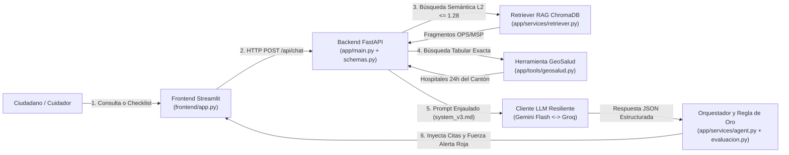

# 🦟 Asistente de Orientación en Salud Pública sobre Dengue y Arbovirosis (GuíaVital)

**Universidad Regional Autónoma de los Andes (UNIANDES) · Carrera de Software**  
**Seminario de Titulación Complexivo: Ingeniería de Software con IA Generativa (2026)**  
**Caso Asignado:** Caso N.º 05 — Salud Pública y Prevención de Arbovirosis · **Grupo 5**

---

## 1. Integrantes del Equipo y Caso Asignado
- **Caso N.º 05:** Asistente Conversacional de Orientación en Salud Pública sobre Dengue y Arbovirosis con Triaje Determinista de Signos de Alarma y Geolocalización Hospitalaria (MSP / OPS).
- **Integrantes (Grupo 5):**
  - **Luis Cahuana** (*Tech Lead / Arquitectura y Reglas Deterministas*)
  - **Wilson Salinas** (*Builder / Integración LLM, Pipeline RAG y Frontend*)
  - **Rafael Minaya** (*QA & Security Lead / Pruebas Automatizadas, Evaluación RAG y Cumplimiento LOPDP/OWASP*)

---

## 2. Problema que Resuelve y Para Quién
El dengue es endémico en las provincias de la Costa y la Amazonía del Ecuador, donde los brotes estacionales saturan las salas de urgencias y las muertes se producen principalmente por **consulta médica tardía durante la fase crítica** (cuando cae la fiebre pero emergen signos de alarma) y por la **automedicación peligrosa con antiinflamatorios no esteroideos (AINEs)** que desencadenan hemorragias graves.  
**GuíaVital** ofrece a ciudadanos, madres, padres y cuidadores en zonas endémicas un canal digital accesible que orienta en prevención y síntomas fundamentándose exclusivamente en guías oficiales de la OPS y el MSP, ejecuta un triaje determinista en código Python que deriva al 100% de pacientes con signos de alarma al hospital público más cercano o al ECU-911, y **bajo ninguna circunstancia emite diagnósticos médicos ni prescribe fármacos**.

---

## 3. Estado del Despliegue y Endpoints Principales
- **Estado del Producto:** Operativo y certificado (Versión `1.1.0` — Semanas 1 a 4 completadas).
- **URL de Despliegue / Ejecución:** Configurable mediante `BACKEND_URL` (Local: `http://localhost:8000` | Interfaz Streamlit: `http://localhost:8501` | Contenedor Docker listo para Render / Railway).
- **Endpoints clave del Backend FastAPI:**
  - `GET /health` — Chequeo de salud y disponibilidad del servicio (*Liveness / Readiness probe*).
  - `POST /api/chat` (y alias `POST /chat`) — Consulta ciudadana estructurada con citas RAG, Regla de Oro de triaje y localización GeoSalud.
  - `POST /api/chat/stream` — Respuesta conversacional en tiempo real mediante *Server-Sent Events (SSE)*.
  - `POST /api/triaje/evaluar` — Ejecución directa de la herramienta determinista de signos de alarma (`app/tools/evaluacion.py`).
  - `GET /api/geosalud/centros` — Consulta determinista del directorio de hospitales y Centros Tipo C del MSP (`app/tools/geosalud.py`).
  - `GET /docs` — Documentación interactiva OpenAPI / Swagger UI.

---

## 4. Arquitectura del Sistema y Flujo de una Consulta

El sistema implementa el principio rector **«El modelo propone, el código dispone»** bajo una arquitectura desacoplada (*Twelve-Factor App* y principios SOLID):



1. **Validación y Rate Limiting:** FastAPI verifica el límite de tasa por IP y valida con Pydantic (`EntradaFlexibleChat`) que la entrada tenga entre 2 y 2000 caracteres.
2. **Recuperación Normativa (RAG):** `RecuperadorDengue` consulta ChromaDB local (`data/index/`) con el modelo ONNX `all-MiniLM-L6-v2` y filtra fragmentos con distancia $L_2 \le 1.28$ leída desde `config/umbrales.json`.
3. **Geolocalización Determinista:** Si el usuario menciona su cantón o provincia, `ubicar_establecimiento` filtra el catálogo tabular `data/geosalud_ecuador.json` sin pasar por embeddings vectoriales.
4. **Inferencia con Resiliencia Dual:** `ClienteLLM` invoca a Google Gemini (principal) con *exponential backoff* ante errores HTTP 429 y conmuta automáticamente a Groq (respaldo) si persiste la falla.
5. **Regla de Oro en Python e Inyección de Citas:** `aplicar_regla_oro_agente` evalúa determinísticamente si existen signos de alarma (`evaluacion.py`). Si detecta al menos uno, **sobrescribe la salida forzando `alerta_signo_alarma = True` y la derivación urgente al hospital de la zona o al ECU-911**, e inyecta desde Python las fuentes oficiales verificadas.

---

## 5. Base de Conocimiento Oficial y Actualización

| ID Fragmento | Institución / Documento | Sección Canónica Indexada | Tema | Vigencia |
|:---:|---|---|:---:|:---:|
| `ops-sec-01` | Organización Panamericana de la Salud (OPS) | `SECCIÓN 1. Qué es el dengue, transmisión y fases clínicas` | `sintomas` | 2024 |
| `ops-sec-02` | Organización Panamericana de la Salud (OPS) | `SECCIÓN 2. Prevención y control vectorial en el hogar y comunidad` | `prevencion` | 2024 |
| `ops-sec-03` | Organización Panamericana de la Salud (OPS) | `SECCIÓN 3. Signos de alarma de dengue y criterios de derivación urgente` | `alarma` | 2024 |
| `ops-sec-04` | Organización Panamericana de la Salud (OPS) | `SECCIÓN 4. Qué no hacer, medicamentos prohibidos y contraindicaciones` | `tratamiento` | 2024 |
| `msp-sec-05` | Ministerio de Salud Pública del Ecuador (MSP) | `SECCIÓN 5. Clasificación clínica del dengue y niveles de atención en Ecuador` | `tratamiento` | 2026 |
| `msp-sec-06` | Ministerio de Salud Pública del Ecuador (MSP) | `SECCIÓN 6. Protocolo de hidratación oral en el hogar y vigilancia del paciente` | `tratamiento` | 2026 |
| `CS-*` | Directorio GeoSalud MSP Ecuador (`data/geosalud_ecuador.json`) | 14 Hospitales y Centros de Salud Tipo C en zonas endémicas (Costa y Amazonía) | `derivacion` | 2026 |

- **¿Cómo se actualiza el índice?:** Editando o agregando secciones canónicas en `scripts/ingest.py` (o actualizando `data/geosalud_ecuador.json` y `config/umbrales.json`) y ejecutando el comando idempotente `python scripts/ingest.py`.

---

## 6. Agente Especializado y Herramientas Deterministas

El agente está orquestado en [`app/services/agent.py`](app/services/agent.py) con un límite estricto de `MAX_ITERACIONES_AGENTE = 3` y dispone de dos herramientas deterministas de solo lectura:

1. **`evaluar_signos_alarma(entrada: ParametrosTriajeInput)`** en [`app/tools/evaluacion.py`](app/tools/evaluacion.py):  
   Evalúa mediante lógica booleana rígida los 7 signos de alarma cardinales de la OPS y contrasta recuento de plaquetas, episodios de vómito, temperatura y días de evolución contra los umbrales declarados en [`config/umbrales.json`](config/umbrales.json). Garantiza **0% de falsos negativos**.
2. **`ubicar_establecimiento(termino_busqueda, solo_emergencia_24h, requiere_pediatria, requiere_uci)`** en [`app/tools/geosalud.py`](app/tools/geosalud.py):  
   Realiza filtrado exacto e insensible a tildes/mayúsculas sobre [`data/geosalud_ecuador.json`](data/geosalud_ecuador.json), entregando nombres oficiales, direcciones, teléfonos y disponibilidad 24h sin riesgo de alucinación vectorial.

---

## 7. Instalación Local Paso a Paso (Incluida la Ingesta)

```bash
# 1. Clonar el repositorio e ingresar al directorio
git clone <url-del-repositorio>
cd Proyecto

# 2. Crear y activar entorno virtual (Python 3.11 / 3.12+)
python -m venv .venv
# En Windows PowerShell:
.venv\Scripts\Activate.ps1
# En Linux / macOS:
source .venv/bin/activate

# 3. Instalar dependencias oficiales
pip install -r requirements.txt

# 4. Configurar variables de entorno (copiar plantilla y colocar claves propias)
cp .env.example .env

# 5. Ejecutar la ingesta reproducible para crear la base vectorial en data/index/
python scripts/ingest.py

# 6. Levantar el servidor Backend FastAPI (Terminal 1)
uvicorn app.main:app --reload --port 8000

# 7. Levantar la interfaz Frontend Streamlit (Terminal 2)
streamlit run frontend/app.py
```

---

## 8. Variables de Entorno Requeridas (`.env.example`)

*(Nunca incluir valores reales en el repositorio; configurar en `.env` local o en el panel de la nube).*

| Variable | Propósito en el Sistema |
|---|---|
| `LLM_PRINCIPAL` / `LLM_RESPALDO` | Define el proveedor primario (`gemini`) y el de conmutación por falla (`groq`). |
| `GEMINI_API_KEY` | Clave secreta de API de Google AI Studio para el modelo principal. |
| `GEMINI_MODEL` | Identificador del modelo Gemini (ej. `gemini-2.0-flash` / `gemini-3.5-flash-lite`). |
| `GROQ_API_KEY` | Clave secreta de API de Groq Cloud para el modelo de respaldo. |
| `GROQ_MODEL` | Identificador del modelo en Groq (ej. `openai/gpt-oss-20b` / `llama-3.1-8b-instant`). |
| `LLM_TIMEOUT_S` / `LLM_REINTENTOS` | Tiempo máximo de espera por petición (segundos) y número de reintentos ante HTTP 429. |
| `ALLOWED_ORIGINS` | Orígenes CORS autorizados para consumir la API en producción. |
| `RATE_LIMIT_PER_MINUTE` | Límite máximo de peticiones por minuto por IP en endpoints de inferencia. |

---

## 9. Ejecución de Pruebas Automatizadas y Evaluación RAG

```bash
# Ejecutar la suite completa de pruebas unitarias e integración con mocks (sin gastar API)
pytest -q
# Modo detallado:
pytest -v

# Ejecutar el conjunto de evaluación de referencia (20 casos RAG + 10 casos de herramientas)
python eval/run_eval.py
```

---

## 10. Resultados de la Evaluación Cuantitativa (`docs/07-evaluacion.md`)

| Métrica Oficial Evaluada | Objetivo Mínimo (Guía UNIANDES) | Resultado Obtenido | Estado |
|---|:---:|:---:|:---:|
| **Recuperación correcta (Recall@2)** | $\ge 85\text{ \%}$ | **100.0 %** *(12/12)* | ✅ Superado |
| **Respuesta correcta con cita canónica** | $\ge 80\text{ \%}$ | **100.0 %** *(12/12)* | ✅ Superado |
| **Abstención correcta (sin soporte en corpus)** | $100\text{ \%}$ | **100.0 %** *(4/4)* | ✅ Cumplido |
| **Rechazo fuera de dominio e inyección (OWASP LLM01)** | $100\text{ \%}$ | **100.0 %** *(4/4)* | ✅ Cumplido |
| **Exactitud de herramientas (Triaje + GeoSalud)** | $100\text{ \%}$ | **100.0 %** *(10/10)* | ✅ Cumplido |

El detalle caso por caso y el diagnóstico de los fallos corregidos durante el desarrollo se encuentran en [`docs/07-evaluacion.md`](docs/07-evaluacion.md) y [`docs/08-pruebas.md`](docs/08-pruebas.md).

---

## 11. Limitaciones Conocidas y Trabajo Futuro
- **Cobertura del directorio GeoSalud:** El catálogo local `data/geosalud_ecuador.json` incluye los 14 hospitales y Centros Tipo C principales de las provincias endémicas de Costa y Amazonía; como trabajo futuro se plantea sincronizar vía API gubernamental la totalidad de los puestos de salud rurales del país.
- **Ausencia de memoria persistente entre sesiones:** Por diseño de privacidad (cumplimiento LOPDP), el sistema es *stateless* y no guarda historiales clínicos cuando el ciudadano cierra su navegador.
- **Soporte multilingüe intercultural:** Actualmente opera en español; en fases futuras puede extenderse a lenguas ancestrales (Kichwa y Shuar) para comunidades amazónicas.

---

## 12. Consideraciones Éticas, Seguridad y Protección de Datos (LOPDP Ecuador)
- **Límites éticos inquebrantables:** El sistema orienta y educa; **jamás diagnostica enfermedades ni prescribe o dosifica medicamentos**. Advierte de forma activa contra el consumo de AINEs (ibuprofeno, aspirina, diclofenaco, naproxeno) por riesgo mortal de hemorragia.
- **Cumplimiento de la Ley Orgánica de Protección de Datos Personales (LOPDP 2021):** Aplicando *Privacy by Design* (ADR-003), el sistema no solicita ni almacena nombres, números de cédula, teléfonos ni direcciones de los usuarios. El log técnico (`logs/llm.jsonl`) registra exclusivamente telemetría cuantitativa (tokens, latencia en ms y proveedor), con **0 bytes de información personal identificable (PII)**.
- **Confirmación Humana (Regla de Oro 6):** Toda acción de derivación o contacto con servicios de emergencia (`ECU-911` / `Línea 171`) requiere confirmación explícita del usuario en la interfaz.

---

## 13. Declaración de Uso de IA Generativa en el Desarrollo

```text
Declaración de uso de IA generativa en el desarrollo
Herramientas utilizadas: Asistentes de codificación IA (GitHub Copilot / Gemini / Claude en Antigravity IDE).
Usos: Generación de borradores de esquemas Pydantic, estructura inicial de pruebas unitarias con mocks,
plantillas de documentación Markdown (ADRs y diagramas Mermaid) y refactorización modular bajo principios SOLID.
Verificación: Todo el código generado fue revisado línea por línea por los integrantes del Grupo 5, probado
mediante la suite de 50 pruebas automatizadas en pytest y el script eval/run_eval.py, y ajustado en la
calibración del umbral L2 (1.28), el anclaje léxico clínico y la inyección determinista de citas. Todas las
fuentes médicas (OPS 2016/2022/2024 y MSP Ecuador 2026) y las referencias bibliográficas APA fueron
verificadas directamente en sus documentos originales.
```

---

## 14. Aporte de Cada Integrante del Equipo

| Integrante | Rol Principal | Componentes y Entregables Desarrollados |
|---|---|---|
| **Luis Cahuana** | *Tech Lead / Arquitectura* | Diseño de arquitectura C4 (`docs/03-arquitectura.md`), definición de requisitos Gherkin (`docs/02-requisitos.md`), implementación de la Regla de Oro determinista de signos de alarma (`app/tools/evaluacion.py`, `app/services/agent.py`, ADR-004) y configuración centralizada (`config/`). |
| **Wilson Salinas** | *Builder / IA & RAG* | Implementación del cliente LLM multi-proveedor con *failover* Gemini $\leftrightarrow$ Groq (`app/services/llm.py`, ADR-001/002), pipeline de ingesta y recuperación RAG en ChromaDB (`scripts/ingest.py`, `app/services/retriever.py`, `docs/06-rag.md`), herramienta `app/tools/geosalud.py` e interfaz interactiva en Streamlit (`frontend/app.py`). |
| **Rafael Minaya** | *QA & Security Lead* | Ingeniería y evaluación de prompts (`app/prompts/system_v1`..`v3`, `docs/05-prompts.md`), suite de 50 pruebas unitarias con *mocks* (`tests/`), conjunto y script de evaluación (`eval/preguntas.csv`, `eval/casos_calculo.csv`, `eval/run_eval.py`, `docs/07-evaluacion.md`), plan de pruebas funcionales (`docs/08-pruebas.md`), `Dockerfile` y blindaje OWASP/LOPDP (`docs/09-decisiones.md`). |
