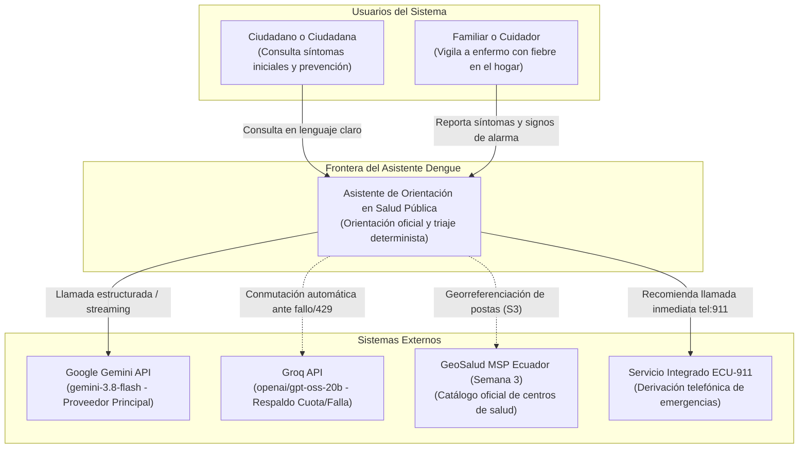
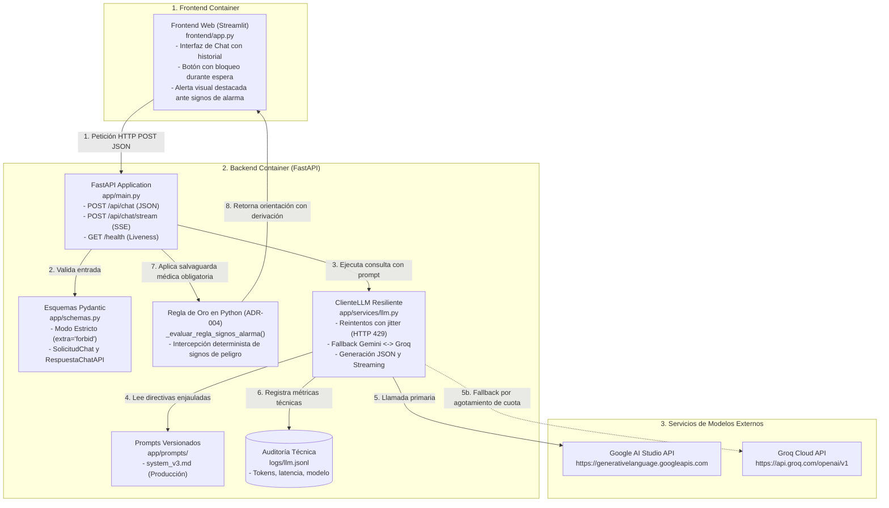

# 03. Arquitectura del Sistema: Asistente de Orientación en Salud Pública (Dengue Ecuador)

## 1. Visión General de la Arquitectura
El sistema adopta una arquitectura desacoplada, modular y resiliente bajo el paradigma **Twelve-Factor App**, diseñada para operar de forma ágil en el MVP (Semana 2) y escalar hacia la nube en semanas posteriores:
- **Capa de Presentación (Frontend):** Interfaz conversacional interactiva construida en **Streamlit**, orientada a ciudadanos y familiares, que no almacena credenciales ni ejecuta lógica clínica, comunicándose exclusivamente con el backend mediante HTTP REST.
- **Capa de Servicios y Orquestación (Backend FastAPI):** API REST asíncrona de alto rendimiento (`app/main.py`) encargada de la validación estricta de esquemas (Pydantic), control de límites anti-inyección (OWASP LLM10) y aplicación de salvaguardas deterministas.
- **Regla de Oro en Python (ADR-004):** «El modelo propone, el código dispone». La detección de signos de alarma de dengue grave (dolor abdominal continuo, vómitos, sangrado) y la orden de derivación médica urgente son ejecutadas por código condicional en Python, garantizando cero omisiones clínicas.
- **Capa de Inteligencia Artificial Generativa (`app/services/llm.py`):** Cliente unificado multi-proveedor con conmutación por falla (fallback) automática entre **Google Gemini** (`gemini-3.8-flash`) y **Groq** (`openai/gpt-oss-20b`), con reintentos exponenciales y jitter ante errores HTTP 429.
- **Observabilidad y Seguridad:** Registro estructurado en `logs/llm.jsonl` con tokens consumidos, tiempo de respuesta y proveedor activo, sin capturar datos personales (cero PII).

---

## 2. Diagramas C4 del Sistema

### 2.1 C4 Nivel 1: Diagrama de Contexto del Sistema

---

### 2.2 C4 Nivel 2: Diagrama de Contenedores

---

## 3. Catálogo de Endpoints del Backend

| Método | Ruta | Propósito | Esquema Entrada | Esquema Salida |
|---|---|---|---|---|
| `POST` | `/api/chat` | Orientación médica estructurada en JSON con salvaguardas y regla de oro. | `EntradaFlexibleChat` | `RespuestaChatAPI` |
| `POST` | `/api/chat/stream` | Orientación conversacional fluida en tiempo real (streaming de texto). | `EntradaFlexibleChat` | Flujo `text/plain` |
| `GET` | `/health` | Chequeo de salud del servicio (liveness / readiness probe). | *Ninguno* | `HealthResponse` |
| `POST` | `/clasificar` | Endpoint de triaje y compatibilidad con el kit de integración. | `Solicitud` | `RespuestaClasificar` |
| `GET` | `/` | Información general del servicio, documentación y directivas. | *Ninguno* | JSON Informativo |

---

## 4. Presupuesto Operativo y Requisitos No Funcionales de IA

1. **Latencia de Respuesta:**
   - Modo estructurado JSON: $\le 3.0$ segundos en condiciones normales de red.
   - Modo streaming: Primer trozo (Time to First Token) en $\le 800$ ms.
2. **Presupuesto de Tokens:**
   - Máximo de tokens de salida configurado: **2048 tokens**.
   - Promedio observado por respuesta ciudadana: 120 a 250 tokens.
3. **Parámetros de Inferencia:**
   - Temperatura: **0.2** (baja variabilidad para garantizar rigor informativo y evitar alucinaciones).
   - Modo estricto Pydantic: `extra="forbid"` forzando cumplimiento del esquema.
4. **Resiliencia ante Fallos del Proveedor (HTTP 429 / 500 / Timeouts):**
   - Número de reintentos: **3 intentos** con espera exponencial y jitter aleatorio.
   - Conmutación automática al proveedor de respaldo si se agota la cuota o el tiempo límite (30s).
5. **Directiva Antialucinación (Kit 3):**
   - El modelo generativo **no genera fuentes**. El campo `fuentes: []` es inyectado exclusivamente por el código en Python (y en la Semana 3 será poblado con los fragmentos recuperados del motor RAG sobre guías oficiales).

---

## 5. Decisiones Arquitectónicas Registradas (ADRs)

Las decisiones técnicas fundamentales del sistema están formalizadas en [`docs/09-decisiones.md`](file:///c:/Users/rminaya/OneDrive%20-%20UNIANDES/Octavo/Seminario/Proyecto/docs/09-decisiones.md):
- **ADR-001:** Cliente LLM desacoplado de endpoints mediante inyección de dependencias (`FastAPI Depends`).
- **ADR-002:** Conmutación por falla (fallback) multi-proveedor Gemini $\leftrightarrow$ Groq con reintentos exponenciales.
- **ADR-003:** Ingesta reproducible y persistencia vectorial local con ChromaDB (preparación Semana 3).
- **ADR-004:** Triaje determinista de signos de alarma de dengue ejecutado en Python puro (Regla de Oro clínica).
