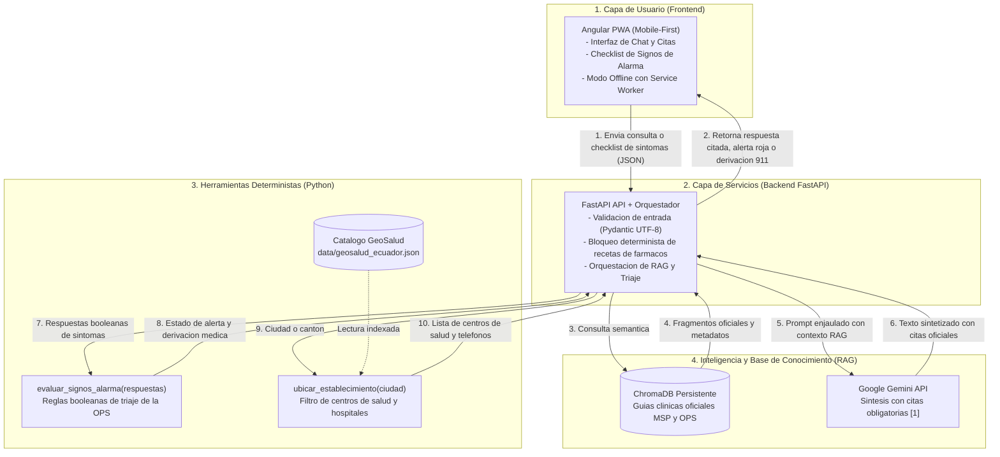
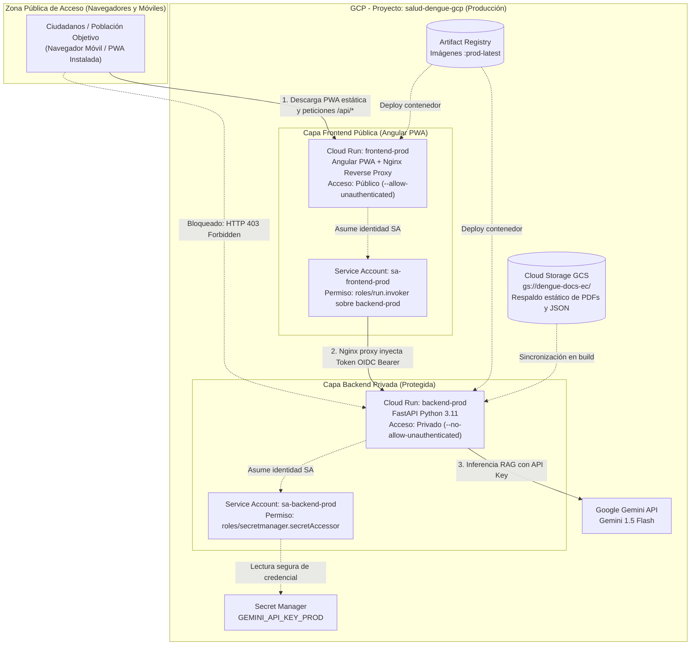
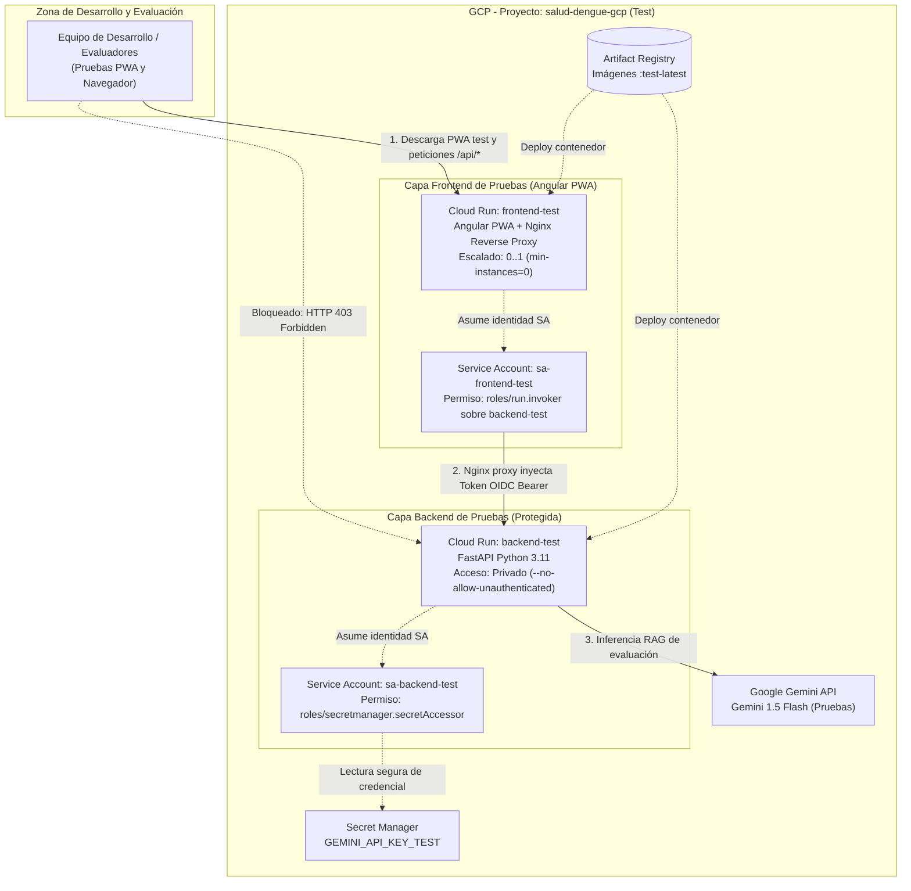

# 03. Arquitectura del Sistema: Asistente de Orientación en Salud Pública

## 1. Visión General de la Arquitectura
El sistema adopta una arquitectura desacoplada, modular y orientada a microservicios livianos bajo el paradigma **Twelve-Factor App**, diseñada para ser desplegada en **Google Cloud Platform (GCP)**:
- **Capa de Presentación (Frontend):** Aplicación Web Progresiva (PWA) construida en **Angular** (TypeScript, Standalone Components, Service Workers), diseñada con enfoque *mobile-first* para ciudadanos en zonas endémicas, permitiendo instalación en pantalla de inicio y soporte offline para consulta básica de signos de alarma.
- **Capa de Servicios y Orquestación (Backend FastAPI):** API REST asíncrona de alto rendimiento construida con Python 3.11+, encargada de validar datos de entrada (Pydantic), orquestar la recuperación vectorial, gestionar la seguridad del paciente y despachar herramientas deterministas.
- **Capa de Inteligencia y Recuperación (RAG Engine):** ChromaDB persistente en disco como motor vectorial de similitud semántica, alimentado con embeddings oficiales, conectado a Google Gemini mediante directivas de sistema ultrarrestrictivas.
- **Capa Determinista (Agent Tools):** Módulos Python puros que ejecutan lógica matemática y condicional rígida (cero alucinación), totalmente independientes del modelo generativo.
- **Infraestructura Cloud (GCP):** Servicios gestionados serverless (Cloud Run, Secret Manager, Cloud Storage, Artifact Registry y Cloud Logging).

---

## 2. Diagrama de Arquitectura Modular del Sistema (Mermaid.js)

### 2.1 Identificación de Datos Faltantes (Gaps de Integración Externa)
- **FALTA:** API REST pública y en tiempo real de GeoSalud del MSP para consulta en vivo de disponibilidad de camas y guardias (se suple mediante el dataset local estático `data/geosalud.json`).
- **FALTA:** Webhook de despacho telemático directo hacia el sistema ECU-911 (se suple mediante derivación en frontend con disparador de llamada `tel:911`).
- **FALTA:** Módulo de autenticación y registro de ciudadanos (el sistema es 100% anónimo y sin login para garantizar 0 bytes de captura de datos personales / PII según RNF-03).
- **FALTA:** Configuración del manifiesto PWA (`manifest.webmanifest`) e iconos de resolución múltiple para compatibilidad nativa en Android e iOS.

### 2.2 Diagrama de Componentes, Flechas y Flujos de Datos

---

## 3. Diagrama de Clases del Sistema (Mermaid.js)

El diseño orientado a objetos y esquemas de validación de datos sigue una estricta separación de responsabilidades:

```mermaid
classDiagram
    %% Modelos Pydantic (Esquemas de Entrada y Salida)
    class BaseModel {
        <<pydantic>>
    }

    class ChatRequest {
        +str mensaje
        +Optional~str~ conversacion_id
        +Optional~str~ ciudad
        +validar_utf8()
        +sanitizar_texto()
    }

    class FuenteReferencia {
        +str documento
        +str origen
        +str seccion_o_pagina
        +str url
    }

    class ChatResponse {
        +str respuesta
        +List~FuenteReferencia~ fuentes
        +bool derivacion_emergencia
        +Optional~str~ aviso_seguridad
    }

    class ChecklistInput {
        +bool dolor_abdominal_continuo
        +bool vomitos_persistentes
        +bool acumulacion_liquidos
        +bool sangrado_mucosas
        +bool letargo_irritabilidad
        +bool mareo_postural
        +bool hepatomegalia_dolorosa
        +bool tiene_fiebre
        +Optional~str~ ciudad
    }

    class EstablecimientoSalud {
        +str? id
        +str? provincia
        +str ciudad
        +str nombre
        +str? nivel
        +str tipo
        +str direccion
        +str telefono
        +bool emergencia_24h
        +List~str~ capacidad_critica
    }

    class TriajeOutput {
        +str clasificacion
        +bool alerta_inmediata
        +List~str~ signos_detectados
        +str accion_recomendada
        +List~EstablecimientoSalud~ establecimientos_cercanos
    }

    class Settings {
        +str APP_ENV
        +str GEMINI_API_KEY
        +str CHROMA_PERSIST_DIR
        +str GEOSALUD_DATA_PATH
        +float RELEVANCE_THRESHOLD
        +int TOP_K_RESULTS
    }

    %% Servicios de Backend
    class RetrieverService {
        -Client chroma_client
        -Collection collection
        -EmbeddingsFunction embed_fn
        +buscar_contexto(query: str, top_k: int) List~DocumentChunk~
    }

    class LLMService {
        -str api_key
        -str model_name
        -float temperature
        +generar_respuesta(prompt_enjaulado: str) str
        +detectar_intencion_farmacologica(texto: str) bool
    }

    class EvaluadorSignosAlarma {
        +evaluar(input: ChecklistInput) TriajeOutput
    }

    class LocalizadorGeoSalud {
        -List~EstablecimientoSalud~ catalogo
        +cargar_catalogo(path: str)
        +buscar_por_ciudad(ciudad: str, solo_urgencias: bool) List~EstablecimientoSalud~
    }

    class AgentOrchestrator {
        -RetrieverService retriever
        -LLMService llm
        -EvaluadorSignosAlarma evaluador
        -LocalizadorGeoSalud geosalud
        -Settings settings
        +procesar_chat(req: ChatRequest) ChatResponse
        +procesar_triaje(chk: ChecklistInput) TriajeOutput
    }

    %% Relaciones
    BaseModel <|-- ChatRequest
    BaseModel <|-- FuenteReferencia
    BaseModel <|-- ChatResponse
    BaseModel <|-- ChecklistInput
    BaseModel <|-- EstablecimientoSalud
    BaseModel <|-- TriajeOutput

    ChatResponse *-- FuenteReferencia
    TriajeOutput *-- EstablecimientoSalud

    AgentOrchestrator --> RetrieverService : utiliza
    AgentOrchestrator --> LLMService : invoca
    AgentOrchestrator --> EvaluadorSignosAlarma : despacha
    AgentOrchestrator --> LocalizadorGeoSalud : consulta
    AgentOrchestrator ..> ChatRequest : recibe
    AgentOrchestrator ..> ChatResponse : produce
    AgentOrchestrator ..> ChecklistInput : recibe
    AgentOrchestrator ..> TriajeOutput : produce
    LocalizadorGeoSalud o-- EstablecimientoSalud : contiene
```

---

## 4. Descripción del Flujo de una Consulta de Principio a Fin

### Escenario A: Consulta Informativa con RAG y Citas (Ej. Medidas de Prevención o Fases Clínicas)
1. **Entrada de Usuario:** El ciudadano ingresa su consulta en la interfaz web (ej. "¿Cómo sé si mi dolor de cuerpo es dengue o gripe común?").
2. **Validación de Entrada:** La petición llega al endpoint `/api/v1/chat` en FastAPI. Se valida mediante el esquema Pydantic `ChatRequest` (sanitización de texto, verificación de codificación UTF-8 y chequeo de inyecciones de prompt).
3. **Filtro de Guardrails (Seguridad):** El backend comprueba si el texto contiene intentos de solicitar prescripción médica directa (ej. "recétame pastillas"). Si detecta intención farmacológica, salta inmediatamente al flujo de rechazo determinista (Regla 3 y 6).
4. **Recuperación Semántica (Retriever):** Si es una consulta legítima, `retriever.py` vectoriza la pregunta usando el modelo de embeddings y consulta la colección en **ChromaDB**. Se recuperan los $k$ fragmentos más cercanos con distancia coseno inferior al umbral de relevancia estipulado.
5. **Composición del Contexto Aumentado:** Si se obtienen fragmentos válidos, se inyectan en el prompt de sistema bajo una directiva cerrada: *"Responde única y exclusivamente con la información del contexto adjunto. Cita el documento y acápite. Si la respuesta no está en el texto, di que no dispones de la información oficial."*
6. **Inferencia en LLM:** Se envía la solicitud al proveedor generativo (Gemini API). El LLM sintetiza la respuesta en lenguaje claro y empático para el ciudadano, incorporando los marcadores de cita `[1]`.
7. **Construcción del Payload:** El backend ensambla el esquema `ChatResponse`, adjuntando en el arreglo `fuentes` el nombre del documento, sección oficial y URL de respaldo.
8. **Presentación en Frontend:** La interfaz renderiza el mensaje, muestra la advertencia estándar de no automedicación y despliega el componente colapsable con las fuentes oficiales verificadas.

---

### Escenario B: Consulta de Triaje de Signos de Alarma (Checklist Determinista)
1. **Activación del Checklist:** El usuario activa la opción de verificación de signos de peligro o el orquestador detecta mención de síntomas agudos e invoca la herramienta.
2. **Captura Estructurada:** El usuario completa las casillas booleanas correspondientes a los 7 signos de alarma definidos por la OPS (dolor abdominal continuo, vómitos persistentes, sangrado de mucosas, mareo postural, somnolencia extrema).
3. **Invocación Determinista (`evaluar_signos_alarma`):** El payload viaja al endpoint `/api/v1/triaje`. El backend ejecuta la función Python pura `app/tools/evaluacion.py:evaluar_signos_alarma(respuestas: Dict[str, bool])`.
   - **Regla inquebrantable:** El LLM **no interviene** en este cálculo.
   - Si $\sum(\text{signos\_alarma}) \ge 1$, el estado es `EMERGENCIA_CRITICA`.
   - Si $\sum(\text{signos\_alarma}) == 0$ y existe fiebre, el estado es `MONITOREO_AMBULATORIO`.
4. **Localización de Centro Asistencial (`ubicar_establecimiento`):** Si hay alarma crítica y el usuario especificó su ciudad (o la proporciona en el paso posterior), el orquestador llama a la función `ubicar_establecimiento(ciudad)`. Esta consulta de forma determinista el archivo `data/geosalud_ecuador.json` y extrae los hospitales o centros Tipo C con servicio de urgencias 24/7.
5. **Despliegue de Emergencia en Frontend:** La pantalla bloquea el chat ordinario y muestra de forma destacada:
   - Banner rojo con instrucciones de traslado urgente.
   - Los signos específicos identificados.
   - Botón directo para marcar al **ECU-911** (`tel:911`).
   - Tabla con los nombres, direcciones y teléfonos de los centros de salud encontrados.

---

> **Compatibilidad de Despliegue (Docker / Cloud Run / PaaS):**  
> El sistema se encapsula bajo el estándar OCI (Docker), garantizando portabilidad integral. Para la evaluación académica del seminario se contempla su despliegue en plataformas PaaS de nivel gratuito o bajo costo (Render / Railway / Hugging Face Spaces) y su extensión hacia Google Cloud Platform (GCP Cloud Run) para entornos institucionales.

## 5. Arquitectura de Despliegue en Google Cloud Platform (GCP) - Enfoque de Bajo Costo y Seguridad IAM

Para maximizar la eficiencia presupuestaria y blindar la seguridad del sistema sin incurrir en costos de redes privadas complejas (VPC/NAT), se implementa una **arquitectura serverless de bajo costo en un único proyecto de GCP**, utilizando **4 servicios en Cloud Run** con **autenticación estricta basada en Service Accounts (SA) y el rol `roles/run.invoker`**:

> **Principio de Aislamiento y Privacidad:**  
> Los servicios de Backend (`backend-prod` y `backend-test`) están configurados con `--no-allow-unauthenticated`. **No son accesibles directamente desde Internet** (cualquier petición externa es rechazada de inmediato con `HTTP 403 Forbidden`). Solo el Frontend respectivo puede invocarlos autenticándose mediante un token de identidad OIDC generado por su Service Account autorizada.

### 5.1 Gaps y Datos Faltantes de Infraestructura (`FALTA:`)
- **FALTA:** Script de aprovisionamiento en Terraform o comandos `gcloud` para la creación de Service Accounts y enlaces IAM (se entregará en la guía de despliegue de la Semana 4).
- **FALTA:** URL definitiva del servicio backend inyectada como variable `BACKEND_SERVICE_URL` en el frontend para el parámetro `audience` del token OIDC.

---

### 5.2 Diagrama de Despliegue - Entorno de Producción (Prod)

---

### 5.3 Diagrama de Despliegue - Entorno de Pruebas (Test)

---

### 5.4 Matriz de Roles IAM y Decisiones de Arquitectura Frontend (Angular PWA)

1. **Patrón Nginx Reverse Proxy con Inyección OIDC en Cloud Run:**
   - La aplicación cliente compilada de **Angular PWA** corre en el navegador del ciudadano. Un navegador web **nunca** debe almacenar credenciales privadas de GCP ni tiene acceso directo a `metadata.google.internal`.
   - Por ello, el contenedor de Cloud Run `frontend-prod` aloja un servidor web **Nginx** liviano que cumple una doble función:
     - **Servir activos estáticos:** Entrega los archivos HTML, CSS, JavaScript empaquetados y el Service Worker (`ngsw-worker.js`).
     - **BFF / Proxy Reverso Autenticado para `/api/*`:** Cuando la SPA Angular invoca una ruta de backend (ej. `/api/v1/chat`), la llamada viaja hacia el Nginx del propio servicio Cloud Run frontend. Nginx solicita un token OIDC a la metadata de GCP bajo la identidad de `sa-frontend-prod`, añade la cabecera `Authorization: Bearer <ID_TOKEN>` y reenvía la petición al servicio privado `backend-prod`.
   - El backend **permanece 100% privado e inaccesible al público**.

2. **Ventajas Clínicas y Operativas de la PWA en Zonas Endémicas:**
   - **Instalabilidad Móvil:** Los ciudadanos en la Costa o Amazonía pueden instalar el asistente en la pantalla de inicio de su teléfono inteligente (Android/iOS) sin pasar por Google Play ni App Store.
   - **Caché y Resiliencia Offline:** Gracias a los Service Workers de Angular (`@angular/service-worker`), si el usuario pierde la conexión 3G/4G, la aplicación sigue abriendo y muestra de manera persistente los 7 signos de alarma del dengue, instrucciones de primeros auxilios (hidratación oral) y los números telefónicos directos de emergencia (ECU-911 y línea 171).

3. **Acceso Mínimo a Secretos (Least Privilege):**
   - `sa-backend-prod` solo tiene el rol `roles/secretmanager.secretAccessor` para la clave de producción.
   - `sa-backend-test` solo tiene acceso a la clave de pruebas.
   - El frontend **no tiene permisos** en Secret Manager (no conoce ni manipula la clave del LLM).

4. **Cero Costo en Reposo (`min-instances = 0`):**
   - Ambos entornos operan bajo demanda (*Request-based CPU*). En ausencia de tráfico, las 4 instancias se reducen a cero, facturando **\$0.00**.

---

## 6. Componentes y Separación de Responsabilidades

| Componente | Archivo / Módulo | Responsabilidad Principal | Regla Ponytail Asociada |
| :--- | :--- | :--- | :--- |
| **API Endpoints** | `app/main.py` | Definición de rutas REST, manejo de ciclo de vida (Lifespan), CORS y middleware UTF-8. | Modularidad y contrato OpenAPI estricto. |
| **Esquemas de Datos** | `app/schemas.py` | Modelos Pydantic para `ChatRequest`, `ChatResponse`, `ChecklistInput`, `TriajeOutput`, `EstablecimientoSalud`. | Validación estricta y tipado estático. |
| **Recuperador RAG** | `app/services/retriever.py` | Conexión a ChromaDB, búsqueda semántica por similitud con filtrado de metadatos. | Regla 1: Lo que afirma, lo cita. |
| **Generador LLM** | `app/services/llm.py` | Cliente para Gemini API, control de tasa (rate limiting, manejo de 429) y prompt enjaulado. | Regla 2: Lo que no sabe, lo dice. |
| **Evaluador de Alarma** | `app/tools/evaluacion.py` | Lógica determinista de evaluación booleana de signos de alarma. | Regla 3: Lo que se calcula, va en código. |
| **Localizador de Salud** | `app/tools/geosalud.py` | Búsqueda y filtrado determinista de establecimientos de salud en dataset local indexado. | Regla 3: Lo que se calcula, va en código. |
| **Configuraciones** | `config/settings.py` | Parámetros de umbrales, nombres de colecciones y rutas estáticas. | Regla 4: Lo que cambia, va en configuración. |
| **Gestión de Secretos** | Secret Manager / `.env` | Claves de API (`GEMINI_API_KEY`) inyectadas como variables de entorno seguras. | Regla 5: Lo que es secreto, no toca el repo. |
| **Frontend UI** | `frontend/` (Angular PWA) | SPA interactiva con TypeScript, Service Worker offline, instalación móvil y proxy Nginx OIDC. | Regla 6: Lo que tiene consecuencias, requiere confirmación. |
